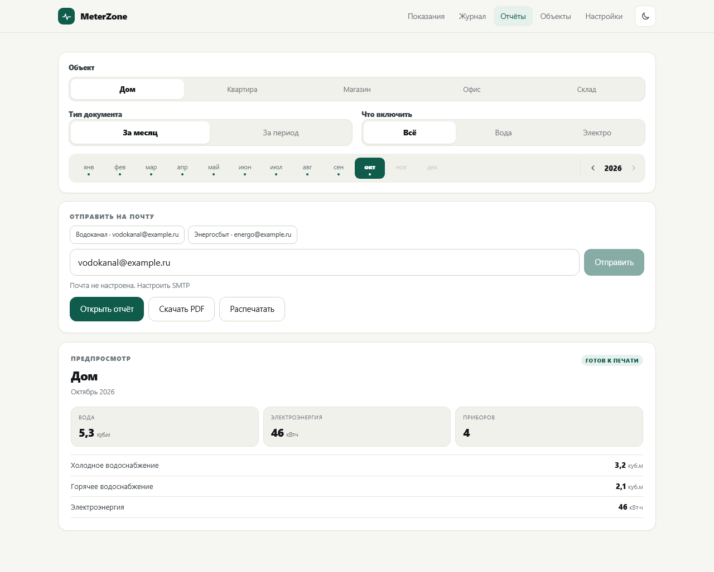
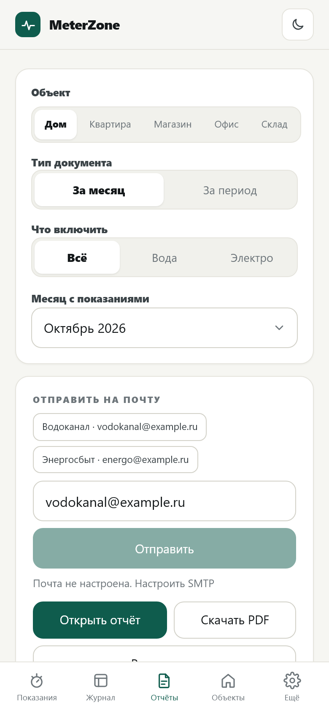

# MeterZone

Учёт показаний счётчиков, начислений и оплат для дома и небольших коммерческих помещений.
Один статический бинарник: внутри SQLite, формирование PDF и веб-интерфейс для телефона и ПК.
Запускается и на Windows, и на роутере Keenetic (Entware, aarch64).

MeterZone by OGNIS.

## Скриншоты

**Компьютер**

| Показания | Журнал |
| --- | --- |
|  |  |

| Отчёты | Объект и приборы |
| --- | --- |
|  |  |

**Телефон**

<p align="center">
  
  
</p>

## Что умеет

- **Объекты** — дома, магазины, офисы: собственник, адрес, лицевые счета, почта водоканала и энергосбыта.
- **Приборы учёта** — холодная и горячая вода, электроэнергия: марка, заводской номер, место, начальное
  показание, дата установки. Замена счётчика — архив старого плюс новый.
- **Дублирующий счётчик** — прибор привязывается к основному и повторяет его показания.
  MeterZone показывает смещение и значение, которое нужно отправить в ресурсную организацию.
- **Ввод показаний** — на главной: выбранный объект и месяц, все счётчики объекта, автоматическое сохранение
  и мгновенный пересчёт расхода и итогов.
- **Финансовый учёт** — по каждому прибору: аванс, счёт и отметка оплаты прямо в поле ввода.
  Режим задаётся у счётчика: только аванс, только счёт или оба.
- **Журнал** — произвольный диапазон месяцев, по каждому счётчику показание и расход, итоги и начисления.
- **Отчёты** — «Сведения» за месяц и «Ведомость» за период, PDF, печать и отправка на почту.
- **Почта** — SMTP с SSL или STARTTLS, проверка подключения, быстрые адреса получателей.
- **Резервные копии** — копия раз в месяц, хранение последних 14, восстановление и выгрузка CSV.
- **Тёмная тема** и смена порта без перезапуска.

## Сборка

Нужен Go 1.23 или новее.

```powershell
go build -o meterzone.exe .
```

Для роутера (Linux, arm64):

```powershell
$env:GOOS='linux'; $env:GOARCH='arm64'; $env:CGO_ENABLED='0'
go build -trimpath -ldflags "-s -w" -o meterzone .
```

## Запуск

```powershell
.\meterzone.exe -port 8099 -db .\data\meterzone.db
```

Откройте `http://localhost:8099`.

Параметры: `-port`, `-host`, `-db`, `-backups`, `-demo` (заполнить пустую базу примерами), `-version`.
Часть параметров можно задать переменными окружения: `PORT`, `HOST`, `APP_DB`, `APP_BACKUP_DIR`, `APP_TZ`.

При первом запуске база создаётся автоматически — она пустая, без примеров. Каталог с базой
и резервными копиями создаётся рядом с программой.

## Установка на роутер Keenetic одной командой

На Keenetic с Entware, по SSH под root:

```sh
curl -fsSL https://raw.githubusercontent.com/ognis163/MeterZone/refs/heads/main/deploy/install.sh | sh
```

Скрипт скачает последний релиз для aarch64, установит его в `/opt/meterzone`,
настроит автозапуск `/opt/etc/init.d/S99meterzone`, запустит сервис и покажет адрес.
Существующая база `data/meterzone.db` не удаляется.

Другой порт:

```sh
curl -fsSL https://raw.githubusercontent.com/ognis163/MeterZone/refs/heads/main/deploy/install.sh | PORT=8090 sh
```

Нужен Keenetic Hopper (aarch64) с Entware и доступом в интернет.
Если нет `curl`, используйте `wget -qO- <тот же адрес> | sh`.

Пошагово, вручную — в [deploy/INSTALL_Keenetic.md](deploy/INSTALL_Keenetic.md).

## Структура репозитория

```
main.go, portbinder.go   точка входа и управление портом
internal/model           типы, периоды, форматирование, деньги
internal/store           SQLite: объекты, приборы, показания, деньги, копии, импорт
internal/report          расчёты расхода и отчётов
internal/pdfdoc          PDF-документы
internal/web             HTTP, шаблоны, стили, скрипты
internal/mail            отправка писем по SMTP
deploy                   скрипт автозапуска и инструкция для Keenetic
```

## Тесты

```powershell
go test ./...
go vet ./...
```

## Лицензия

MIT, см. [LICENSE](LICENSE).
