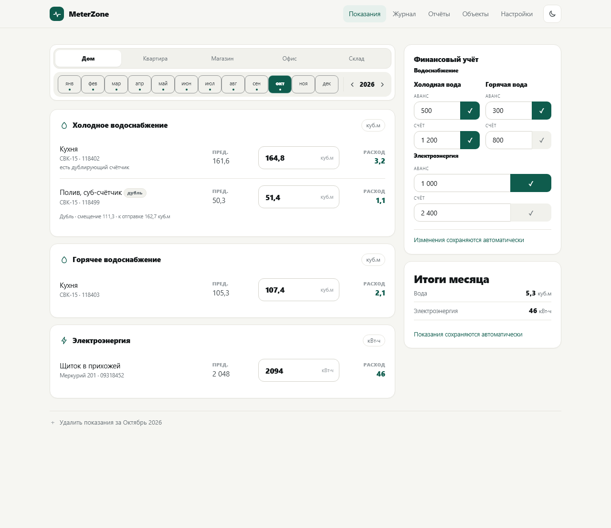
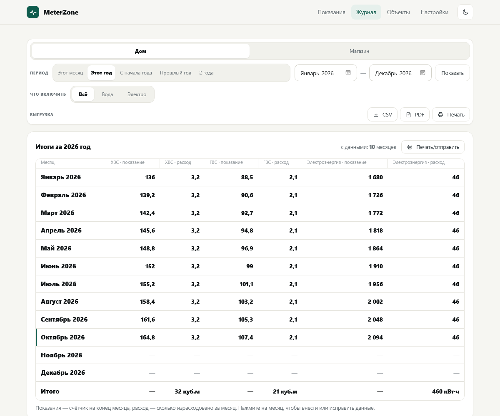
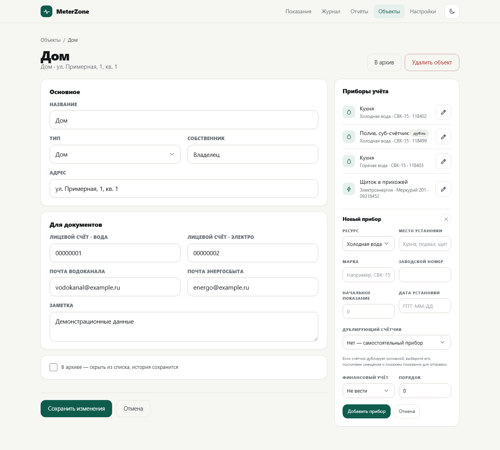
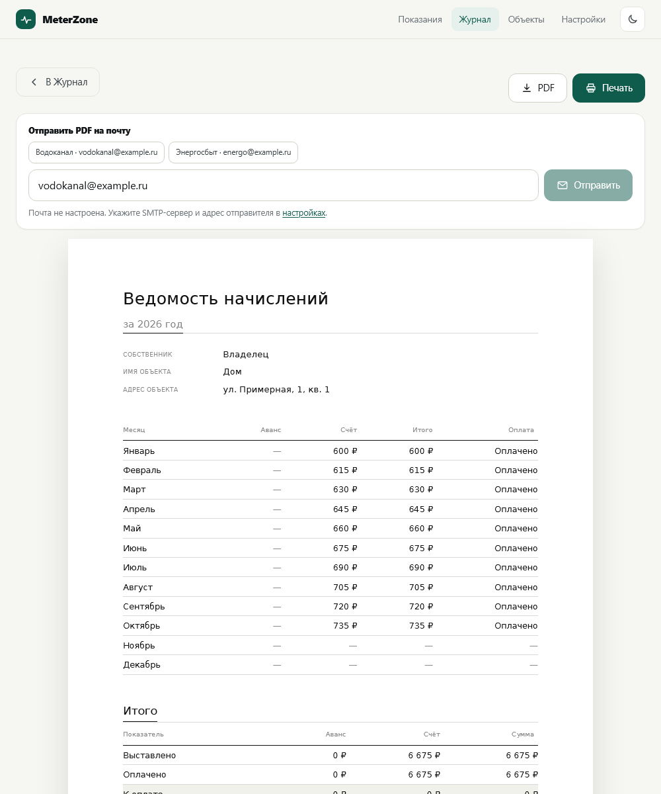
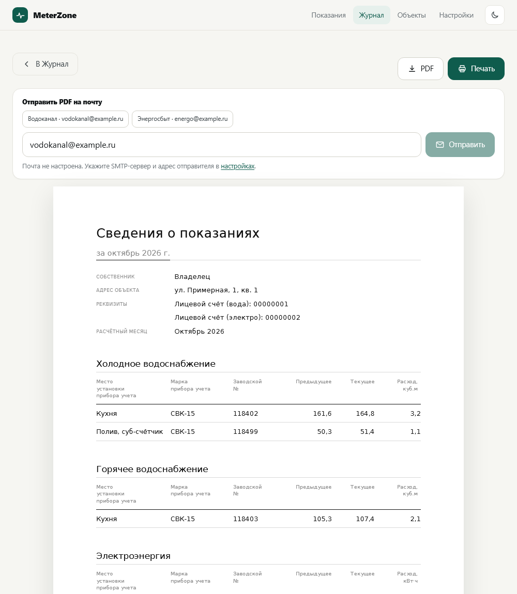
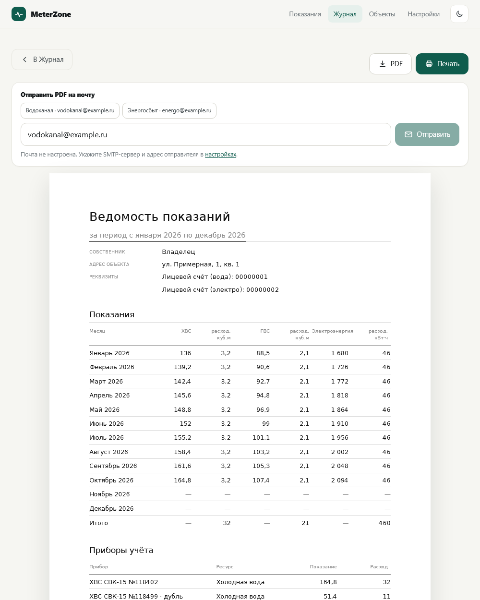
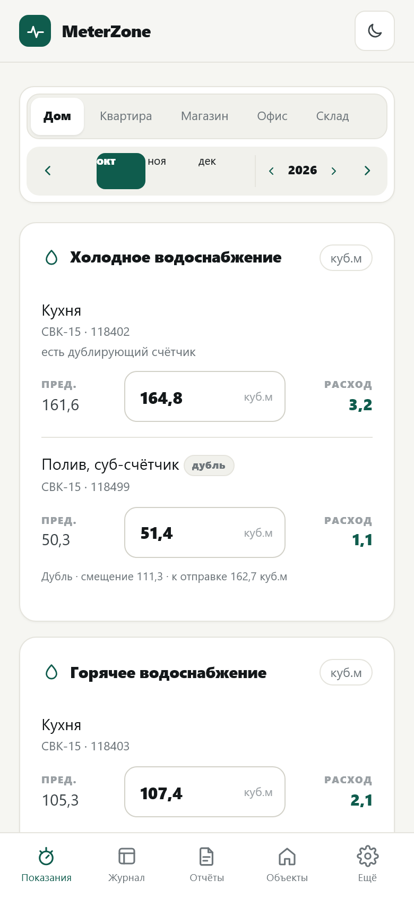
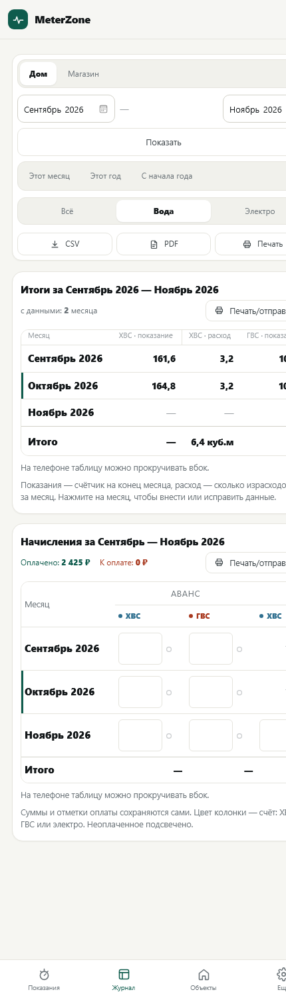

# MeterZone 1.2

Учёт показаний счётчиков, начислений и оплат для дома и небольших коммерческих помещений.
Один статический бинарник: внутри SQLite, формирование PDF и веб-интерфейс для телефона и ПК.
Запускается и на Windows, и на роутере Keenetic (Entware, aarch64).

MeterZone by OGNIS.

## Скриншоты

**Компьютер**

| Показания | Журнал |
| --- | --- |
|  |  |

| Объект и приборы | Ведомость начислений |
| --- | --- |
|  |  |

**Документы для печати**

| Сведения о показаниях | Ведомость показаний |
| --- | --- |
|  |  |

**Телефон**

<p align="center">
  
  
</p>

## Установка как приложение на телефон

На iPhone откройте сайт в Safari, нажмите «Поделиться» → **На экран «Домой»**.
Приложение откроется без панелей и кнопок Safari — как обычное приложение.
На Android: меню браузера → **Установить приложение**.

Если ярлык был добавлен раньше, удалите его и добавьте заново — старый ярлык
открывает Safari с панелями.

## Что умеет

- **Объекты** — дома, магазины, офисы: собственник, адрес, лицевые счета, почта водоканала и энергосбыта.
- **Приборы учёта** — холодная и горячая вода, электроэнергия: марка, заводской номер, место, начальное
  показания, дата установки. Замена счётчика — архив старого плюс новый.
- **Дублирующий счётчик** — прибор привязывается к основному и повторяет его показания.
  MeterZone показывает смещение и значение, которое нужно отправить в ресурсную организацию.
- **Ввод показаний** — на главной: выбранный объект и месяц, все счётчики объекта, автоматическое сохранение
  и мгновенный пересчёт расхода и итогов.
- **Начисления** — по каждому счёту: аванс, счёт и отметка оплаты. В журнале колонки «Аванс» и «Счёт» делятся
  на ХВС, ГВС и электро (по настройкам приборов), цвета колонок и подсветка неоплаченного; всё правится на месте.
  Режим задаётся у счётчика: только аванс, только счёт или оба.
- **Журнал** — один раздел: произвольный диапазон месяцев, по каждому счётчику показания
  и расход, итоги и начисления. Выгрузка выбранного периода: CSV, PDF и печать.
- **Документы** — «Сведения о показаниях», «Ведомость показаний» и «Ведомость начислений»
  открываются одной страницей: PDF, печать и отправка на почту.
- **Почта** — SMTP с SSL или STARTTLS, проверка подключения, быстрые адреса получателей.
- **Резервные копии** — копия раз в месяц, хранение последних 14, восстановление и выгрузка CSV.
- **Тёмная тема** и смена порта без перезапуска.

## Сборка

Нужен Go 1.23 или новее.

```powershell
go build -o meterzone.exe .
```

Для роутера (Linux, arm64):

```powershell
$env:GOOS='linux'; $env:GOARCH='arm64'; $env:CGO_ENABLED='0'
go build -trimpath -ldflags "-s -w" -o meterzone .
```

## Запуск

```powershell
.\meterzone.exe -port 8099 -db .\data\meterzone.db
```

Откройте `http://localhost:8099`.

Параметры: `-port`, `-host`, `-db`, `-backups`, `-demo` (заполнить пустую базу примерами), `-version`.
Часть параметров можно задать переменными окружения: `PORT`, `HOST`, `APP_DB`, `APP_BACKUP_DIR`, `APP_TZ`.

При первом запуске база создаётся автоматически — она пустая, без примеров. Каталог с базой
и резервными копиями создаётся рядом с программой.

## Установка на роутер Keenetic одной командой

На Keenetic с Entware, по SSH под root:

```sh
curl -fsSL https://github.com/ognis163/MeterZone/releases/latest/download/install.sh | /opt/bin/sh
```

Скрипт скачает последний релиз для aarch64, установит его в `/opt/meterzone`,
настроит автозапуск `/opt/etc/init.d/S99meterzone`, запустит сервис и покажет адрес.
Существующая база `data/meterzone.db` не удаляется.

Другой порт:

```sh
curl -fsSL https://github.com/ognis163/MeterZone/releases/latest/download/install.sh | PORT=8090 /opt/bin/sh
```

Если время в приложении отличается от местного, задайте часовой пояс:

```sh
curl -fsSL https://github.com/ognis163/MeterZone/releases/latest/download/install.sh | APP_TZ=Europe/Moscow /opt/bin/sh
```

Нужен Keenetic Hopper (aarch64) с Entware и доступом в интернет.
Если нет `curl`, используйте `wget -qO- <тот же адрес> | /opt/bin/sh`.

Пошагово, вручную — в [deploy/INSTALL_Keenetic.md](deploy/INSTALL_Keenetic.md).

## Структура репозитория

```
main.go, portbinder.go   точка входа и управление портом
internal/model           типы, периоды, форматирование, деньги
internal/store           SQLite: объекты, приборы, показания, деньги, копии, импорт
internal/report          расчёты расхода и отчётов
internal/docgen          документы: общая модель, PDF через gpdf и сетка печати
internal/third_party     форк раскладки и отрисовки gpdf с исправлением позиций
internal/web             HTTP, шаблоны, стили, скрипты
internal/mail            отправка писем по SMTP
deploy                   скрипт автозапуска и инструкция для Keenetic
```

## Документы

«Сведения о показаниях» и «Ведомость показаний» описываются один раз —
в `internal/docgen` (тип `Document`): заголовок, реквизиты, разделы
с таблицами и подпись. Из этой модели собираются оба вывода:

- PDF — `docgen.PDF`, собирается библиотекой gpdf (чистый Go, без
  зависимостей); это основной файл для печати и отправки на почту;
- HTML-предпросмотр — `templates/document.html` и `assets/doc.css`.

Сетка общая: A4, поля 22 мм, DejaVu Sans, кегли 7–19 pt, только
волосяные линии — без рамок, заливок и полужирного. Поэтому лист
в браузере и PDF совпадают по типографике.

## Тесты

```powershell
go test ./...
go vet ./...
```

## Лицензия

MIT, см. [LICENSE](LICENSE).
